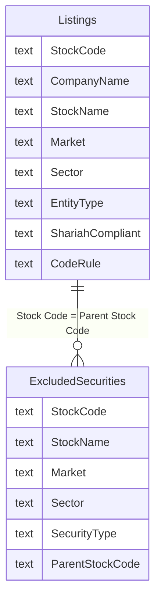

# Bursa Malaysia Listed Companies

A clean, checked list of **every entity listed on Bursa Malaysia**: **1,136 listed entities** on the Main, ACE
and LEAP markets, taken from Bursa Malaysia's own listings as at **28 October 2026**. Each row has the stock code,
the full registered name, the short stock name, the market, Bursa's sector, the entity type, the Shariah flag
and a link to the official Bursa company profile.

A further **162 securities** (warrants, preference shares and rights) were taken out of the company list,
because they are not separate companies. They are kept in their own table, and each one is linked back to its
listed parent.

The list is published as two CSV files and a **Power BI Project** (Power Query, a two-table model, DAX and four
report pages). The project loads the data straight from this repository, so anyone can open it and refresh.

**Built with:** Power BI (Power Query M, DAX, PBIP / TMDL), Python for data preparation and checks.

---

## How the universe was built

The source is Bursa Malaysia's public equities price list, which can be filtered by market and sector.

1. **Every market × sector combination** of the price list was downloaded, all pages.
2. **Row counts were checked** against Bursa's own total for each combination. All of them matched.
3. **Only ordinary shares and units were kept.** That means 4-digit stock codes on the Main and ACE markets,
   5-digit codes on the LEAP Market, plus one named exception: a stapled security (`5235SS`).
4. **Other securities were set aside, with a reason.** Warrants, preference shares and rights entitlements of
   listed companies went to a separate *Excluded Securities* table. Structured warrants, ETFs and bonds trade on
   separate Bursa boards, so they were never in scope.
5. **Full registered names** came from Bursa's official stock search, matched by exact stock code. Every entity
   matched, and the short stock names agreed in every case.

Values are copied as Bursa records them. For example, Bursa often shortens *Berhad* to *BHD*, and that spelling is
kept. The sector is Bursa's own classification, and the Shariah flag is the `[S]` marker on Bursa's price list.

## The universe at a glance

| Market | Listed entities | Companies | REITs, trusts and funds | Shariah-compliant | Sectors |
|---|---|---|---|---|---|
| Main Market | 814 | 792 | 22 | 650 | 15 |
| ACE Market | 272 | 272 | 0 | 222 | 12 |
| LEAP Market | 50 | 50 | 0 | 36 | 7 |
| **Total** | **1,136** | **1,114** | **22** | **908** | **15** |

The 22 non-company entities on the Main Market are **19 REITs**, **1 business trust**, **1 closed-end fund** and
**1 stapled security**.

**Listed entities by sector and market:**

| Sector (Bursa) | Main | ACE | LEAP | Total |
|---|---|---|---|---|
| Industrial Products & Services | 219 | 90 | 13 | 322 |
| Consumer Products & Services | 181 | 51 | 14 | 246 |
| Technology | 56 | 59 | 14 | 129 |
| Property | 96 | 2 | – | 98 |
| Construction | 56 | 23 | 5 | 84 |
| Energy | 35 | 10 | – | 45 |
| Plantation | 40 | 1 | 1 | 42 |
| Financial Services | 32 | 4 | 2 | 38 |
| Transportation & Logistics | 28 | 7 | – | 35 |
| Telecommunications & Media | 17 | 15 | – | 32 |
| Health Care | 20 | 9 | 1 | 30 |
| Real Estate Investment Trusts | 20 | – | – | 20 |
| Utilities | 12 | 1 | – | 13 |
| Business Trust | 1 | – | – | 1 |
| Closed End Fund | 1 | – | – | 1 |

**Excluded securities:**

| Type | Main | ACE | LEAP | Total |
|---|---|---|---|---|
| Warrants | 100 | 43 | 2 | 145 |
| Preference shares | 11 | 5 | – | 16 |
| Rights entitlements | 1 | – | – | 1 |
| **Total** | **112** | **48** | **2** | **162** |

They belong to 151 different listed entities.

## Power BI version

[`powerbi/BursaListedCompanies.pbip`](powerbi/) is a Power BI Project: the model, the Power Query steps and the
report are saved as text files.



- **Power Query:** both queries read the CSV files in [`data/`](data/) from this repository through one
  `DataFolder` parameter. Every CSV column is typed as text, so stock codes keep their leading zeros (`0001`,
  `03019`). Power Query then adds three things:
  - a **Market Order** column, so Main, ACE and LEAP sort in that order instead of alphabetically;
  - a **Code Rule** column that re-applies the inclusion rule on every refresh. Anything that breaks the rule
    shows as *Check*;
  - a **Parent Stock Code** for each excluded security: its code minus the suffix (the first 4 characters, or 5
    on the LEAP Market).
- **Relationship:** `ExcludedSecurities[Parent Stock Code]` (many) to `Listings[Stock Code]` (one), so the market
  and sector slicers on the listed companies also filter their warrants and preference shares.

```m
IsDigits = (code as text) as logical => Text.Select(code, {"0".."9"}) = code,
CodeRule = Table.AddColumn(MarketOrder, "Code Rule", each
    if [Stock Code] = "5235SS" then "Stapled security (named exception)"
    else if not IsDigits([Stock Code]) then "Check"
    else if Text.Length([Stock Code]) = 4 and [Market] <> "LEAP Market" then "4-digit code (Main / ACE)"
    else if Text.Length([Stock Code]) = 5 and [Market] = "LEAP Market" then "5-digit code (LEAP)"
    else "Check", type text)
```

**Measures:**

| Table | Measures |
|---|---|
| Listings | Listed Entities, Company Listings, Non-Company Entities, Sectors, Shariah-Compliant, Shariah-Compliant %, % of All Listings, Code Rule Exceptions |
| ExcludedSecurities | Excluded Securities, Warrants, Preference Shares, Rights Entitlements, Listings With Other Securities, Parent Found % |

```dax
% of All Listings = DIVIDE ( [Listed Entities], CALCULATE ( [Listed Entities], ALL ( Listings ) ) )
Parent Found %    = DIVIDE ( COUNTROWS ( FILTER ( ExcludedSecurities,
                        NOT ISBLANK ( RELATED ( Listings[Stock Code] ) ) ) ), [Excluded Securities] )
```

**Pages:**

| Page | What it shows |
|---|---|
| **Overview** | headline cards, listed entities by market (stacked by Shariah status), by sector and by entity type, with market and entity-type slicers |
| **Sectors** | a sector × market matrix with a colour scale, plus each sector's share of all listings and its Shariah-compliant share |
| **Company List** | every listed entity with a link to its Bursa profile, with market, sector, entity-type and Shariah slicers |
| **Excluded & Checks** | the excluded securities by market and type, each with its listed parent, and the inclusion-rule check on the listed universe |

**To open it:** clone or download the repository and open `powerbi/BursaListedCompanies.pbip` in Power BI Desktop.
Choose **Anonymous** when asked how to connect to `raw.githubusercontent.com`. To use a local copy of the data
instead, set the `DataFolder` parameter to that folder and change `Web.Contents` to `File.Contents`.

*Report screenshots will be added once the report is published.*

## Data quality handling

Every check below runs in the preparation script, and the script stops without writing if any of them fails.

- **Reconciled with the original summary:** all 34 market × sector counts, and the totals for each market, match
  the summary that was produced when the list was built.
- **Unique keys:** stock code, company name and stock name are each unique across the 1,136 listed entities. No
  code appears in both the listed and the excluded tables.
- **Inclusion rule:** every listed stock code follows the rule (1,085 four-digit codes, 50 five-digit LEAP codes,
  1 stapled security). Power BI checks it again on every refresh.
- **Every excluded security has its parent:** all 162 parent codes exist in the listed universe, with the same
  market and sector, and every excluded stock name starts with its parent's stock name (for example
  `DIGISTA-WD` → `DIGISTA`).
- **Official links only:** every profile link is Bursa's own company-profile address for that stock code.
- **Complete and consistent:** there are no blank cells, the market is always Main, ACE or LEAP, and the Shariah
  flag is always Yes or No.
- **No personal data:** the files hold exchange listing facts only. There are no people, emails or phone numbers.

**Snapshot, not a live feed:** listings change every day (new listings, delistings, transfers between markets).
Suspended counters with no trading may not appear on the price list. Check Bursa Malaysia before relying on any
single row.

## Data

[`data/bursa_listed_companies.csv`](data/bursa_listed_companies.csv): 1,136 rows × 8 columns.

| Column | Meaning |
|---|---|
| Stock Code | Bursa stock code (text: keep the leading zeros) |
| Company Name | full name as registered on Bursa |
| Stock Name | Bursa's short trading name |
| Market | Main Market, ACE Market or LEAP Market |
| Sector | Bursa's sector classification |
| Entity Type | Company, REIT, Business Trust, Closed-End Fund or Stapled Security |
| Shariah Compliant | Yes / No, from the `[S]` marker on Bursa's price list |
| Bursa Profile URL | the entity's official company-profile page on Bursa Malaysia |

[`data/bursa_excluded_securities.csv`](data/bursa_excluded_securities.csv): 162 rows × 6 columns (Stock Code,
Stock Name, Market, Sector, Security Type, Why Excluded).

## Repository layout

```
data/bursa_listed_companies.csv      1,136 listed entities (public listing facts)
data/bursa_excluded_securities.csv   162 warrants, preference shares and rights
powerbi/BursaListedCompanies.pbip    open this in Power BI Desktop
powerbi/*.SemanticModel/             TMDL model: tables, Power Query, measures, relationship
powerbi/*.Report/                    report pages and visuals (PBIR)
```
