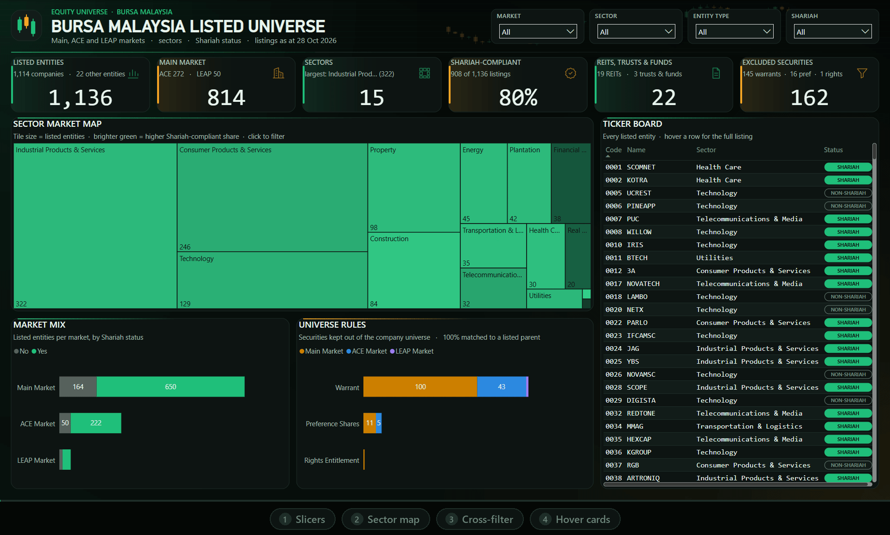

# Bursa Malaysia Listed Universe (Power BI)

A clean, checked list of **every entity listed on Bursa Malaysia** as at 28 October 2026: **1,136 listed entities**
on the Main, ACE and LEAP markets, plus **162 excluded securities** (warrants, preference shares and rights), each
linked to its listed parent. The data is public and published here as two CSV files with a one-page Power BI
dashboard.

## What's inside
- **Sector treemap** coloured by Shariah-compliant share (908 of the 1,136 entities are Shariah-compliant).
- **Market mix:** Main 814 · ACE 272 · LEAP 50.
- **Universe rules:** what was excluded and why (145 warrants, 16 preference shares, 1 rights entitlement).
- **Ticker board** with Shariah badges and a link to each entity's official Bursa profile.
- KPI tiles with live subtitles and slicers in the header. Click any visual to cross-filter the page; hover a
  listing to see its card.

## How it's built
- Every market × sector page of Bursa's public price list was downloaded, and the row counts matched Bursa's own
  totals. Full registered names come from Bursa's stock search, matched by exact stock code.
- **Inclusion rule:** 4-digit codes on Main and ACE, 5-digit codes on LEAP, plus one named stapled security. Power
  Query re-applies the rule on every refresh and flags anything that breaks it.
- Stock codes are read as text, so leading zeros stay (`0001`, `03019`). Each excluded security joins to its listed
  parent by code.
- The prep script stops if any check fails: unique keys, no blanks, every parent found, official links only.
- The 1920×1080 background artboard and theme are generated in Python.

## Open it
- Open `powerbi/BursaMalaysiaListedUniverse.pbip` in Power BI Desktop and choose **Anonymous** when asked how to
  connect to `raw.githubusercontent.com`. It loads the CSV files from this repository.
- Data: [`data/bursa_listed_companies.csv`](data/bursa_listed_companies.csv) (1,136 rows) and
  [`data/bursa_excluded_securities.csv`](data/bursa_excluded_securities.csv) (162 rows). Exchange listing facts
  only, no personal data.
- This is a snapshot, not a live feed: check Bursa Malaysia before relying on any single row.

**Tools:** Power BI (PBIP), Power Query (M), DAX, Python · built with Claude Code as a coding assistant
